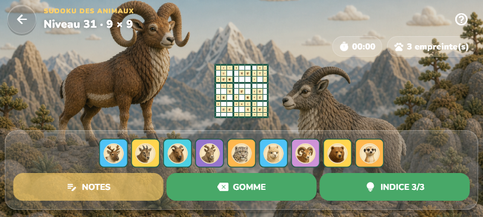
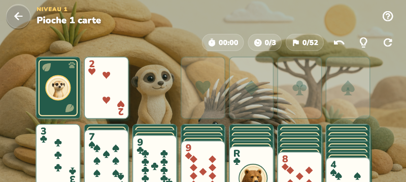
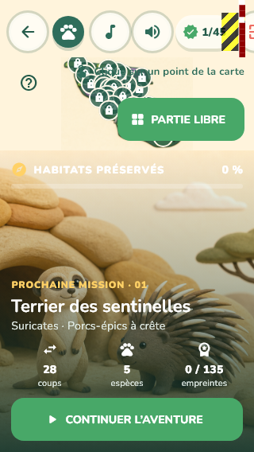

# Audit technique et jouabilité — Papatte Parc

Date : 22 octobre 2026. État audité : répertoire de travail basé sur `e97fce8`, avec ses modifications locales et fichiers non suivis. Les huit jeux présents ont été examinés. Aucun changement de code applicatif ni d'illustration source n'est réalisé par cet audit.

## Verdict

L'architecture est globalement cohérente : application Flutter unique, logique des jeux séparée de leur présentation, sauvegardes locales séparées, thème et composants partagés. Il est pertinent de la conserver. La cohérence est toutefois incomplète dans les dispositions, les parcours de sélection, les zooms et la gestion du temps.

Les problèmes les plus urgents concernent la surface réellement jouable en paysage court et la sélection des niveaux sur petit écran. Le potentiel d'allègement le plus concret concerne les images. Une réécriture générale, ou une migration vers un autre moteur, ne se justifie pas sur les éléments observés.

L'interface du jeu n'est pas une interface HTML/CSS classique : Flutter dessine les écrans. Les proportions se corrigent dans `lib/`, pas avec des media queries ajoutées à `web/index.html`.

## Méthode et limites

- Lecture des couches application, shared, domaines, contrôleurs de parcours, sauvegardes, présentations, tests et configuration de distribution.
- Flutter 3.44.9, Dart 3.12.2, hôte Windows. Analyse statique, suite existante et compilation Web release.
- Ouverture réelle du Web compilé dans le navigateur intégré, navigation menu → niveaux Mahjong → partie. Aucun avertissement/erreur capturé dans la console sur ce parcours limité.
- Sondes de widgets réutilisant les scénarios visuels existants : 320 × 568, 800 × 360, 1024 × 600, 900 × 900, 2560 × 1080, DPR 1 ; seconde série à texte 200 % en 360 × 800. Les scénarios particuliers existants des dix paniers et de l'écran 611 × 896 sont également conservés.
- Première série stricte : les exceptions de mise en page font échouer les tests. Série d'inventaire : les exceptions sont explicitement consommées et imprimées pour continuer à capturer les écrans suivants. **La mention “All tests passed” de ces inventaires ne signifie donc pas que les dispositions sont correctes.**
- Les captures d'inventaire sont nouvelles et stockées séparément ; les références visuelles du projet ne sont pas mises à jour. Les copies temporaires de tests ont été supprimées après exécution.
- Les tailles de fichiers sont des mesures locales, pas des temps de chargement mobile. Pas de mesure FPS/GPU/batterie sur téléphone, ni de qualification native Android/iOS/macOS/Linux. Aucun test réseau 4G limité, cache froid contrôlé ou CDN de production.

## Résultats des vérifications

| Vérification | Résultat |
| --- | --- |
| `flutter analyze`, après suppression des sondes temporaires | Aucune anomalie |
| `flutter build web --release` | Réussit, y compris le dry run Wasm ; ce dry run n'est pas une qualification d'une distribution Wasm |
| Première suite `flutter test --reporter expanded` | 95 réussites, 3 échecs ; exécutée avec compilation Web/analyse concurrentes |
| Suite finale `flutter test --concurrency=1 --reporter expanded` | **96 réussites, 2 échecs**, environ 2 min 59 s ; les deux écarts visuels persistent, le test de durée Mahjong passe |
| Échecs visuels de cette suite | Numberlink : 697 pixels, 0,24 % ; Repas : 136 230 pixels, 47,30 %, en 360 × 800 |
| Échec de durée de cette suite | Test des 45 plateaux Mahjong : 29,78 s pour une limite de 15 s ; résultat sous contention, à distinguer des performances isolées |
| Sondes strictes de nouveaux formats | 9 scénarios réussis, 4 échoués ; arrêts précoces sur le premier débordement de chaque scénario |
| Inventaires de captures | Débordements confirmés en 320 px, paysage court et texte 200 % ; détails ci-dessous |

Une seconde exécution séquentielle de la suite existante est consignée dans `evidence/baseline-serial.txt` et résumée dans la section de clôture. Les écarts visuels doivent être examinés : ils peuvent provenir des changements graphiques locaux. Il ne faut pas les effacer par une régénération automatique des références.

La compilation signale aussi une référence à la famille CupertinoIcons absente des fontes déclarées. Le rendu parcouru fonctionne ; vérifier les icônes et leur fallback avant livraison.

## Constats prioritaires

### P1 — Le paysage court n'a pas de disposition réellement adaptée

**Preuves :** `lib/shared/game_stage_layout.dart:24`, `:57`, `:62`, `:144` ; écrans Sudoku, Mahjong, Numberlink, Match-3 et Solitaire.

Le mode large requiert une largeur d'au moins 900 pixels **et** un format paysage. Un téléphone en 800 × 360 reste donc dans la colonne verticale. Le HUD réserve 94 pixels, puis le panneau inférieur prend sa hauteur et ne laisse presque plus de place au plateau. Le panneau du mode large a pour sa part une largeur fixe de 340 pixels.

Constats des captures en 800 × 360 :

- Sudoku 9 × 9 : plateau d'environ 90 pixels de côté, donc environ 10 pixels par case, malgré l'absence d'exception sur l'écran de partie.
- Mahjong : plateau minuscule et débordement de 40 pixels sur l'écran de résultat.
- Numberlink : débordement de 40 pixels sur le résultat.
- Match-3 : débordement de 30 pixels sur le résultat.
- Solitaire : bas des cartes coupé en partie ; débordement de 94 pixels sur le résultat.
- Refuge : carte des niveaux évincée par la fiche mission ; débordement de 73 pixels à l'accueil et de 50 pixels sur le résultat.

Les exceptions de résultat et les plateaux trop petits en partie sont deux défauts distincts.

**Correction proposée :** calculer la disposition sur l'espace utilisable et la géométrie du jeu. Prévoir portrait, paysage court et paysage large. En paysage court, commandes latérales compactes ; en portrait, commandes sous le plateau ; sur grand écran, panneau latéral plafonné mais flexible. Mesurer le HUD plutôt que supposer une hauteur fixe. Rendre les résultats défilables quand nécessaire, tout en gardant les actions principales accessibles.

Ne pas simplement baisser le seuil 900 : un panneau fixe de 340 pixels consommerait encore trop d'espace sur un téléphone paysage. Ne pas réduire tout l'écran avec un FittedBox : cela masquerait les débordements tout en réduisant les cibles.

### P1 — La sélection des niveaux devient trop petite et ambiguë

**Preuves :** `lib/shared/park_journey_map.dart:103-115`, `:196`, `:242` ; `lib/shared/campaign_level_select_screen.dart:69-75`, `:447` ; carte propre au Refuge dans `home_screen.dart:533`.

La carte est ajustée entièrement à son espace, avec des marqueurs de 26/32/38 pixels, puis un InteractiveViewer de facteur 1 à 3. Aucun cadrage initial sur le niveau courant, aucune commande visible +/−/recentrer, aucune alternative en liste.

Sur une carte de 360 pixels de large respectant le ratio source, les centres des niveaux 7 et 8 sont distants d'environ **7,1 pixels** pour des disques de 26 pixels. 64 paires de centres sont à moins de 26 pixels. Ce calcul géométrique considère les 45 points ; il ne signifie pas que 64 paires de niveaux sont simultanément jouables au début.

Le zoom actuel agrandit les disques en même temps que leurs distances : il **ne résout pas les superpositions**. Élargir seulement les zones tactiles les aggraverait.

En 320 × 568, le bandeau de sélection commun déborde de **38 pixels à droite**, avec bouton Quitter fourni dans le scénario Windows. La fiche mission conserve un grand espace décoratif et réduit fortement la carte. À texte 200 %, plusieurs sélections débordent encore de 28 pixels en 360 × 800.

**Parcours proposé :**

1. Entrée dans un jeu : afficher la mission courante avec un bouton Continuer directement accessible.
2. Cadrage initial de la carte sur la zone courante et ses voisines, dans la partie libre de l'écran. Conserver une commande Vue du parc.
3. Tap sur un point : sélectionner, montrer titre/difficulté/record/état et bouton Jouer ; même fonctionnement dans les huit jeux. Aujourd'hui le Refuge ouvre une fiche et les autres démarrent directement.
4. Ajouter +, − et Recentrer ; conserver pinch, molette et navigation au clavier.
5. Positionner les marqueurs dans un calque de coordonnées écran, avec taille tactile stable. Aux endroits denses, décaler les points avec traits de rappel ou présenter un groupe ouvrant ses niveaux. Une liste numérotée reste toujours disponible.
6. Au retour d'une partie, conserver niveau sélectionné et caméra. Après victoire, proposer le suivant sans déplacer la caméra pendant une interaction. Adapter le cadrage à la rotation et respecter la réduction des animations.

Sur téléphone, remplacer la grande fiche illustrée permanente par une fiche compacte ou déployable. En paysage court, utiliser une fiche latérale. La carte reste l'élément principal de sélection, sans supprimer les illustrations.

### P1 — Les images pénalisent le chargement et le paquet

**Mesures sources :**

| Groupe | Poids local |
| --- | ---: |
| 45 illustrations `assets/level_art/` | 112,19 Mio |
| Sokoban | 10,92 Mio |
| Match-3 | 5,69 Mio |
| Audio | 4,96 Mio |
| Food sort | 4,86 Mio |
| Couverture Mahjong | 2,37 Mio |
| Couverture Solitaire | 2,29 Mio |
| Carte | 2,07 Mio |

Le répertoire source `assets/3d/` pèse 175,10 Mio mais **n'est pas déclaré dans le pubspec** et n'apparaît pas dans les assets Web compilés : ne pas le compter comme téléchargement actuel du jeu.

L'export Web observé représente environ **187,47 Mio** : assets 147,16 Mio, moteurs CanvasKit distribués 36,69 Mio, JavaScript principal 2,65 Mio, plus icônes et amorçage. Ce total inclut plusieurs variantes de moteur ; ce n'est pas le volume téléchargé lors d'une visite. `main.dart.js` vaut environ 0,77 Mio après gzip calculé localement, sans preuve du comportement de compression du serveur final.

Lors de l'ouverture réelle du menu, les logs du serveur local montrent les demandes de la carte et de six illustrations totalisant **16,01 Mio d'images sources**. Certaines cartes sont préparées avant d'être visibles. Le menu utilise `Image.asset(..., fit: BoxFit.cover)` sans petite variante (`main_menu_screen.dart:342`). Aucun `cacheWidth`/`cacheHeight` ni préchargement ciblé n'a été trouvé dans `lib/`.

Une illustration typique de 1672 × 941 représente environ 6 Mio de pixels RGBA décodés, indépendamment du poids de son fichier. Plusieurs images et textures peuvent donc exercer une pression sur le cache et la mémoire graphique ; le pic réel reste à profiler.

**Correction proposée :**

- Conserver les sources haute qualité ; générer des vignettes, des fonds intermédiaires et des fonds haute résolution.
- Évaluer WebP sur les décors opaques, avec comparaison visuelle à taille réelle et agrandie. Garder un format adapté aux transparences et traits nets des petits éléments. Aucun gain de compression chiffré n'est promis sans essai d'encodage.
- Utiliser des variantes selon dimensions physiques/DPR et un plafond de résolution raisonnable. Vérifier le comportement du renderer Web avant de compter sur les seules options de décodage Flutter.
- Charger le fond de la mission sélectionnée, puis éventuellement le suivant ; ne pas précacher les 45 décors.
- Garder le chargement paresseux du menu, limiter son préchargement hors écran et fournir un placeholder harmonisé.
- Dédupliquer les paires Sokoban identiques octet pour octet : feeding-spot/v2, fence/v2, food-crate/mixed, après vérification des références. Le gain est secondaire face aux décors.
- Mesurer séparément transfert froid, transfert chaud, premier menu utilisable et première partie utilisable sur le serveur de production.

### P2 — Des reconstructions sont déclenchées dix fois par seconde

**Preuves :** contrôleurs Refuge, Mahjong, Sudoku, Numberlink ; par exemple `mahjong_game_flow.dart:67-84`, `sudoku_game_flow.dart:68-85`.

Le timer de 100 ms appelle setState sur le contrôleur de parcours alors que `formatDuration` n'affiche que minutes et secondes. Cela reconstruit les widgets de l'écran et des données de présentation ; au Mahjong, la liste des tuiles présentes est notamment reconstruite et triée. Ce constat ne prouve pas à lui seul une chute de FPS.

**Correction proposée :** conserver une mesure exacte de durée mais notifier seulement le widget chronomètre à la seconde ; notifier plateau et commandes lors des changements du jeu. Employer de petits widgets const et des écouteurs ciblés avant d'ajouter des caches ou RepaintBoundary partout. Le plateau Repas possède déjà une RepaintBoundary.

### P2 — Le calcul des niveaux peut bloquer l'interface

Les 45 Sudoku sont construits synchroniquement dans initState (`sudoku_game_flow.dart:60`) et chaque grille vérifie son unicité. La génération Mahjong et ses recherches sont également synchrones au lancement d'une partie (`mahjong_game_flow.dart:113-119`, `domain/mahjong_generator.dart:25-57`). Le générateur contient plusieurs recherches bornées ; le coût par appareil reste à mesurer.

Refuge et Repas utilisent déjà compute pour certaines générations. **Sur le Web, compute utilise la boucle d'événements courante**, contrairement à l'isolate natif : l'appel seul ne garantit donc pas une interface fluide.

**Correction proposée :** chronométrer chaque générateur et le temps d'ouverture de chaque jeu en release/profile. Préparer à la demande et mémoriser les niveaux fixes ; pour les tâches réellement coûteuses, isolate natif et stratégie Web mesurée (travail découpé ou worker compatible). Afficher un état de préparation et empêcher une réponse tardive de remplacer une autre session après navigation. Préserver seeds, solutions, difficulté et règles d'unicité.

### P2 — Cohérence technique partielle entre les huit jeux

| Aspect | État | Action recommandée |
| --- | --- | --- |
| Domaines, sessions, modèles | Séparation claire par jeu | Conserver les moteurs distincts |
| Thème, Nunito, palette, HUD | Partagés | Centraliser espacements, rayons, voiles, tailles et règles adaptatives encore locales |
| Carte de campagne | Commune à sept jeux, copie spécifique au Refuge | Unifier caméra, marqueurs et fiche de sélection avec adaptateurs |
| Écrans de partie | GameStageLayout utilisé par les huit jeux | Ajouter un contrat géométrique par plateau plutôt qu'un unique booléen wide |
| Résultats | Implémentations séparées, débordements sur hauteur réduite | Coque commune défilable, contenu et actions propres au jeu |
| Flux de jeu | Répétitions audio, retour, réglages, timers, messages | Extraire les services et petits composants récurrents |
| Sauvegardes | Préfixes séparés, classes souvent proches | Petit stockage typé commun, stratégies de score distinctes |
| Réglages | Clés communes effectives | Injecter SettingsStore aussi dans le Refuge au lieu d'y recopier les clés |
| Catalogue du parc | Interface ParkStage partagée, données importées du Refuge à la racine | Déplacer les métadonnées de parcours dans shared sans modifier les configurations de jeu |

Éviter une superclasse de contrôleur remplie d'options pour tous les jeux : la génération, la victoire, l'annulation et les records n'ont pas les mêmes règles. Une extraction progressive de la caméra, du temps, de l'audio, du chrome d'écran et du stockage offre un meilleur rapport simplicité/risque.

Le README annonce sept jeux alors que huit sont présents et emploie un ancien nom pour le jeu de tri. Les descriptions du pubspec et du manifest parlent encore seulement de déduction. Un petit catalogue de jeux typé peut alimenter les cartes, titres, identifiants et liens d'aide, avec des adaptateurs de progression.

### P2 — Progression finale et sens du temps à préciser

`CampaignLevelSelectScreen` calcule `(level - 1) / itemCount` (`:370`) à partir du niveau débloqué. Les stores plafonnent ce dernier à 45. La jauge ne peut donc jamais atteindre 100 % par cette formule, même après la dernière victoire. Séparer dernier niveau débloqué, niveaux terminés et niveau sélectionné, en réutilisant les records existants lorsque possible.

Aucun observateur de cycle de vie applicatif n'a été trouvé dans lib. Plusieurs jeux cumulent les écarts DateTime, alors que le Solitaire ajoute une seconde par callback. Après suspension/onglet masqué, ces approches peuvent donner des comportements différents. Définir une politique commune : pause lors de la mise en arrière-plan, reprise explicite ou automatique, audio interrompu, temps actif cohérent. Ajouter un test de suspension et de reprise avant de modifier les chronomètres.

### P2 — Accessibilité et modes d'entrée à compléter

Il existe déjà des Semantics, des tooltips et du clavier, notamment dans Numberlink et Repas. La couverture reste inégale : les tuiles personnalisées et cartes tactiles ne deviennent pas toutes utilisables au clavier par la seule présence d'un label Semantics.

Les marqueurs de 26 pixels, boutons de 40 pixels et commandes réduites par FittedBox ne satisfont pas l'objectif tactile de 48 pixels recommandé par Flutter. Pour les plateaux denses, conserver une grille lisible au zoom et proposer un mode de sélection précis plutôt que superposer artificiellement de grandes zones.

À texte 200 %, les sondes en 360 × 800 relèvent des débordements de 28 pixels dans plusieurs sélections, 86 pixels dans la configuration du Refuge et 59 pixels dans la configuration Repas. Le jeu doit adapter/faire défiler ses contrôles, sans désactiver globalement l'agrandissement du texte.

Vérifier aussi : focus visible, ordre Tab, activation Entrée/Espace, souris et tactile, contraste des textes sur chaque fond, reconnaissance sans dépendre uniquement de la couleur, réduction des animations et lecture TalkBack/VoiceOver.

## HTML, CSS, distribution et plateformes

`web/index.html` reste l'amorçage Flutter standard. Il n'existe pas de système de CSS applicatif concurrent à harmoniser. Les règles visuelles sont dans les widgets et app_theme.dart ; les valeurs locales peuvent être regroupées progressivement.

À améliorer côté Web :

- Langue `fr` sur le document et description réelle ; icônes et métadonnées conformes à l'identité du jeu.
- Écran d'amorçage léger avec identité, état de chargement, erreur et possibilité de réessayer au lieu d'un body initialement vide. Ne pas y charger un décor de plusieurs Mio.
- Le manifest demande `portrait-primary` alors que des dispositions paysage existent. Autoriser les deux orientations si elles sont corrigées ; ne pas promettre le même comportement d'installation sur tous les navigateurs.
- Vérifier zoom navigateur, viewport, barres mobiles, encoche, SafeArea, mode installé et reprise après changement d'onglet. Ne pas corriger les proportions en bloquant le zoom ou l'agrandissement du texte.
- Définir et tester la politique de cache et de mise à jour. La présence d'un script de service worker de compatibilité n'est pas une preuve de fonctionnement hors ligne. Si le hors-ligne est voulu, choisir les contenus à télécharger explicitement ; ne pas précacher aveuglément tout l'export.
- Test de déploiement sous le sous-répertoire GitHub Pages déjà configuré : assets, audio, rafraîchissement et nouvelle version. L'audit interactif utilise la racine localhost.

Le dépôt fournit actuellement Web, Android et Windows. Les dossiers de projets natifs iOS, macOS et Linux sont absents. La compilation release Android est configurée avec la clé debug (`android/app/build.gradle.kts`) : ce n'est pas une configuration de livraison boutique.

Le workflow Pages compile et publie sans étape flutter analyze/test, et suit stable sans version Flutter figée. Ajouter une version SDK reproductible, analyse et tests fonctionnels sur Linux, puis vérification des références visuelles sur Windows. Les goldens sont aujourd'hui explicitement ignorées hors Windows.

## Revue par jeu : ce qui doit rester spécifique

| Jeu | Point principal de jouabilité | Vérification à ajouter |
| --- | --- | --- |
| Balises du refuge | Carte spécifique, petit plateau initial, zoom existant | Paysage court, révéler/baliser, zoom centré sans clic involontaire |
| Align'Animaux | Plateau carré comprimé par les objectifs | Cases lisibles, swap au doigt/souris, commandes pendant les animations |
| Mahjong | Zoom existant mais cadrage initial trop petit en paysage court | 32 à 144 tuiles, lecture des couches, zoom/recentrage et clavier |
| Solitaire | Largeur des cartes calculée sans garantir la hauteur des piles | Piles longues en cours de partie, pioche 1/3, sélection et glisser-déposer sans coupure |
| Défi des Papattes | Grilles 4/6/9, palette et actions consomment la hauteur | Taille minimale des cases, notes lisibles et saisie sans décaler le plateau |
| Sentiers sauvages | Traçage continu sur petit plateau, sans zoom de plateau actuel | Geste précis, départ/arrivée, annulation et clavier ; séparer pan et tracé si zoom ajouté |
| Repas des animaux | Placement indépendant des commandes ; pinch existant avec pan désactivé | Grandes cartes, zones hors champ après zoom, déplacement du soigneur et retour au cadrage |
| Réserves du parc | Chariot proportionné, paniers arrière plus petits ; scroll de secours existant | Dix paniers, cibles arrière, lisibilité de la nourriture et commande dans les deux orientations |

## Plan d'exécution sans changement des règles

### Lot 1 — Retrouver une surface jouable

Adapter GameStageLayout et les résultats ; corriger les bandeaux à 320 pixels ; adapter réellement Solitaire, Sudoku et les autres plateaux au paysage court ; rendre la fiche de campagne compacte lorsque l'espace manque.

Acceptation : aucun débordement, aucune carte/action coupée sur la matrice ci-dessous ; taille utile du plateau mesurée et approuvée, pas seulement absence d'exception. Les mêmes parties restent jouables après rotation/redimensionnement.

### Lot 2 — Sélection des niveaux et caméra commune

Unifier les deux cartes, introduire sélection + fiche + Jouer, caméra contrôlée, recentrage, marqueurs stables et traitement des regroupements, liste de secours. Préserver les niveaux verrouillés/déverrouillés et les records.

Acceptation : atteindre chaque niveau débloqué au doigt, souris et clavier ; aucune sélection rendue inaccessible par un autre point ; cadrage conservé au retour ; 100 % atteint après la dernière victoire.

### Lot 3 — Images et chargement

Créer la chaîne de génération de variantes, remplacer d'abord les images du menu, puis fonds et petits sprites ; ajouter amorçage et préchargement ciblé. Mesurer avant/après sur le même appareil, réseau et cache.

Acceptation proposée à calibrer avec les appareils cibles : réduire d'au moins 70 % les octets d'images demandés par le menu observé, sans perte visible validée côte à côte ; menu utilisable en moins de 3 secondes à chaud et objectif de 5 secondes à froid sur un profil réseau/appareil défini. Ces valeurs sont des cibles proposées, pas des résultats de cet audit.

### Lot 4 — Simplification et performances d'exécution

Isoler chronomètres et cycle de vie ; mutualiser réglages/audio/stockage/chrome récurrents ; déporter ou découper les calculs mesurés coûteux. Faire de petites extractions, chacune accompagnée des vérifications fonctionnelles existantes.

Acceptation : scores, clés de sauvegarde, seeds et solutions conservés ; même suite fonctionnelle ; pas de gel visible à l'ouverture d'un jeu ni à la création du niveau le plus coûteux. Profiler CPU/raster et mémoire avant d'ajouter des optimisations de rendu spécifiques.

### Lot 5 — Qualification et distribution

CI, politique de cache et audio Web, configuration Android de livraison, puis tests sur appareils et navigateurs réels. Corriger les références visuelles seulement après revue des rendus attendus.

## Matrice de qualification proposée

| Axe | Couverture minimale |
| --- | --- |
| Formats logiques | 320 × 568, 360 × 800, 390 × 844, 568 × 320, 800 × 360, 844 × 390, 611 × 896, 768 × 1024, 1024 × 600/768, 900 × 900, 1366 × 768, 1920 × 1080, 2560 × 1080 |
| Échelle | DPR 1/2/3 ; texte 100/150/200 % ; zoom navigateur ; Windows 125/150 % |
| États | Menu, campagne au début/milieu/fin, libre, génération, jeu, longues piles, victoire/défaite, pause/reprise, rotation, retour système |
| Entrées | Tactile un/deux doigts, souris, molette, clavier, lecteur d'écran |
| Appareils | Petit Android réel et Android intermédiaire, iPhone/Safari Web si cible, iPad/tablette, Windows ; autres plateformes natives seulement après ajout de leur projet |
| Réseau | Cache froid/chaud, débit limité, hors ligne si prévu, mise à jour entre versions, échec d'un asset/audio |
| Règles | 45 niveaux de chaque jeu, fin de campagne, génération déterministe/solvable, scores, undo/indices, records et anciennes sauvegardes |
| Performance | Premier écran utilisable, première partie utilisable, p95/p99 des frames, temps des générateurs, mémoire après 20 changements de niveaux/jeux, audio et consommation en arrière-plan |

À 60 Hz, viser un travail par frame compatible avec 16,7 ms ; à 120 Hz, 8,3 ms. Ce sont des budgets d'affichage, pas une garantie d'obtenir le même FPS sur tous les appareils. Fixer les critères définitifs après une référence mesurée sur les appareils cibles.

## Références techniques consultées

- [Flutter : conception adaptative](https://docs.flutter.dev/ui/adaptive-responsive/best-practices) : petits composants et prise en compte des fenêtres redimensionnables.
- [Flutter : performances](https://docs.flutter.dev/perf/best-practices) : limiter les reconstructions et mesurer les effets graphiques coûteux.
- [Flutter : compute](https://api.flutter.dev/flutter/foundation/compute.html) : distinction boucle d'événements Web/isolate natif.
- [Flutter : profilage Web](https://docs.flutter.dev/perf/web-performance) : mesure dans Chrome DevTools.
- [Flutter : accessibilité](https://docs.flutter.dev/ui/accessibility) : cibles tactiles, contraste, agrandissement et lecteurs d'écran.

## Clôture des vérifications

La relance de la suite existante, sans compilation concurrente et avec `--concurrency=1`, termine avec **96 tests réussis et 2 échecs**. Les échecs sont les deux références visuelles Numberlink et Repas déjà identifiées. Le test des 45 plateaux Mahjong passe dans cette exécution : le dépassement initial ne constitue donc pas un défaut de performance isolé confirmé. Cela ne qualifie pas pour autant les performances du générateur sur mobile ou Web.

L'analyse statique définitive est propre. La compilation Web release réussit. Le code applicatif, les assets sources et les goldens existantes sont conservés ; seuls le rapport et son dossier d'évidence sont ajoutés. Les mesures de performances utilisateur sur matériel mobile restent à faire.

Évidence conservée : [analyse](evidence/analyze.txt), [suite séquentielle](evidence/baseline-serial.txt), [sondes strictes](evidence/responsive-strict.txt), [inventaire responsive](evidence/responsive-inventory.txt), [inventaire texte 200 %](evidence/text200-inventory.txt), [mesures des assets](evidence/mesures-assets.json). Les captures des sondes illustrent des défauts observés, pas des propositions graphiques.
